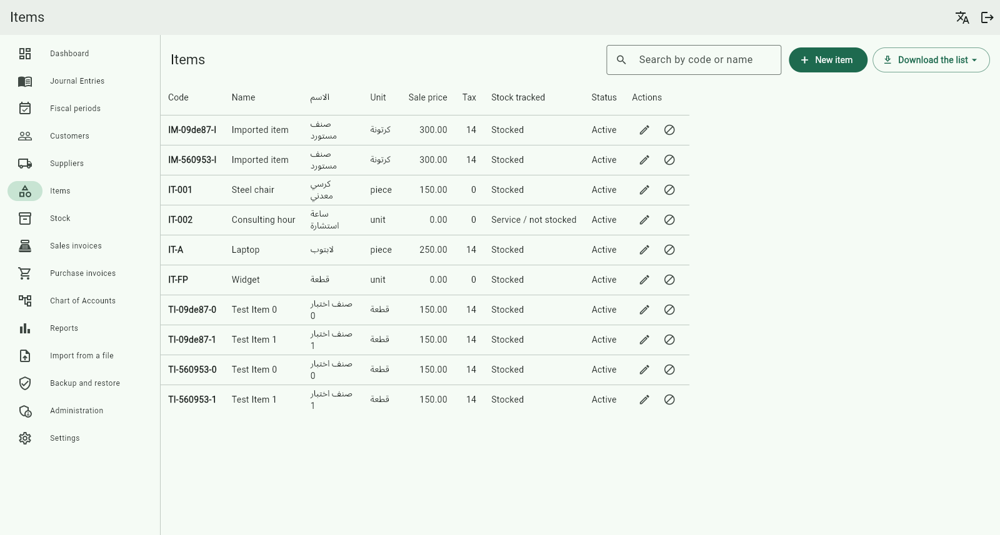
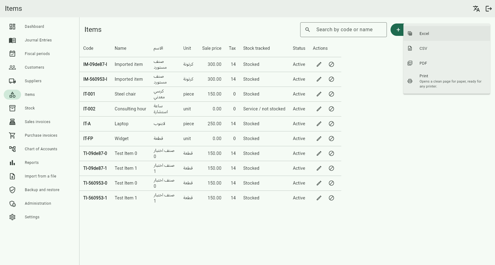
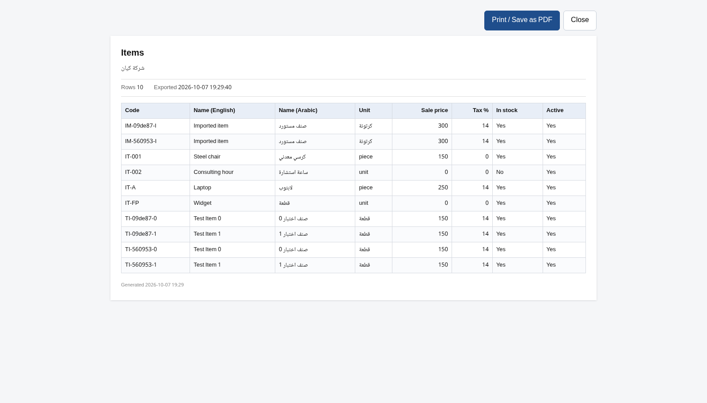

# دليل استخدام نظام كيان ERP

## كتالوج عملي للمستخدم والمسؤول

**حالة المستند:** مسودة مصوّرة جزئيًا للمراجعة، مبنية على قراءة شجرة العمل الحالية. الصور الثلاث المتاحة لواجهة الأصناف محفوظة سابقًا في المستودع وتعرض واجهة قديمة باللغة الإنجليزية؛ لا تثبت شكل الإصدار الحالي. لم تُشغّل الواجهة أو تُختبر العمليات عمليًا أثناء إعداد هذا الدليل. بعض الوظائف الموصوفة موجودة في تعديلات محلية لم تُدمج بعد، وقد تختلف عن النسخة المثبتة لديك. المرجع: الفرع `arena/2d794f08-erp-kayan`، وHEAD ‏`320eab32c8debfe39a3fc75bbf9ebaebb189f5b1`، بالإضافة إلى تغييرات شجرة العمل القائمة عند إعداد الدليل.

> قبل تطبيق أي خطوات على بيانات حقيقية، راجع الصلاحيات والإعدادات مع مسؤول النظام والمحاسب، وجرّب الإجراءات في بيئة تدريب مستقلة. الترحيل والعكس والإقفال والاستعادة إجراءات مؤثرة على البيانات.

---

## فهرس الدليل

1. [التعرف على النظام وبدء الاستخدام](#1-التعرف-على-النظام-وبدء-الاستخدام)
2. [لوحة التحكم والتنقل](#2-لوحة-التحكم-والتنقل)
3. [الشركة والفروع والإعدادات](#3-الشركة-والفروع-والإعدادات)
4. [المستخدمون والأدوار والصلاحيات](#4-المستخدمون-والأدوار-والصلاحيات)
5. [العملاء والموردون](#5-العملاء-والموردون)
6. [الأصناف والوحدات والباركود](#6-الأصناف-والوحدات-والباركود)
7. [المخزون وحركة الصنف](#7-المخزون-وحركة-الصنف)
8. [فواتير المبيعات والمشتريات](#8-فواتير-المبيعات-والمشتريات)
9. [المرتجعات](#9-المرتجعات)
10. [عروض الأسعار](#10-عروض-الأسعار)
11. [الخزائن والبنوك](#11-الخزائن-والبنوك)
12. [دليل الحسابات والقيود](#12-دليل-الحسابات-والقيود)
13. [مراكز التكلفة والموازنات](#13-مراكز-التكلفة-والموازنات)
14. [الأرصدة الافتتاحية والفترات المالية](#14-الأرصدة-الافتتاحية-والفترات-المالية)
15. [الأصول الثابتة والإهلاك](#15-الأصول-الثابتة-والإهلاك)
16. [التقارير والطباعة والتصدير](#16-التقارير-والطباعة-والتصدير)
17. [استيراد البيانات والنسخ الاحتياطي](#17-استيراد-البيانات-والنسخ-الاحتياطي)
18. [مساعدة المستخدم وحل المشكلات](#18-مساعدة-المستخدم-وحل-المشكلات)
19. [دورة عمل تدريبية مقترحة](#19-دورة-عمل-تدريبية-مقترحة)
20. [فهرس الشاشات وحدود التحقق](#20-فهرس-الشاشات-وحدود-التحقق)

---

## 1. التعرف على النظام وبدء الاستخدام

كيان ERP يجمع بيانات الأصناف والمخزون والعملاء والموردين والمبيعات والمشتريات والقيود المحاسبية والخزائن والتقارير في نظام واحد. تعتمد الشاشة والأزرار المتاحة على صلاحيات الحساب وإعداد الشركة والنسخة المستخدمة.

### ما تحتاج إليه قبل البدء

- نسخة عاملة من البرنامج وخادم الشركة المتاح، وفق إعداد مسؤول النظام.
- حساب مستخدم فعّال وصلاحيات مناسبة للعمل المطلوب.
- بيانات تجريبية منفصلة إذا كان الهدف التدريب؛ لا تستخدم بيانات عميل أو إنتاج في التدريب.
- الاتفاق مع المسؤول المحاسبي على الحسابات والفترات والضرائب وبيانات الافتتاح قبل الترحيل.

### تسجيل الدخول

1. افتح البرنامج وانتظر ظهور شاشة تسجيل الدخول.
2. اكتب اسم المستخدم وكلمة المرور المخصّصين لك، ثم اختر **تسجيل الدخول**.
3. خيار **تذكرني** اختياري؛ لا تستخدمه على جهاز مشترك دون موافقة سياسة الشركة. يمكن مسح البيانات المحفوظة من الشاشة.
4. بعد الدخول تظهر لوحة التحكم أو الشاشة المسموح بها. للخروج استخدم **تسجيل الخروج** من الإعدادات.

إذا تعذّر الدخول، راجع اسم المستخدم وحالة الحساب واتصال البرنامج بالخادم مع المسؤول. لا ترسل كلمة مرورك في رسالة دعم.

## 2. لوحة التحكم والتنقل

- تعرض **لوحة التحكم** ملخصات عن نشاط الشركة بحسب البيانات والصلاحيات المتاحة؛ راجع التاريخ والفرع قبل تفسير أي رقم.
- انتقل من قائمة البرنامج إلى القسم المطلوب: المبيعات، المشتريات، المخزون، المحاسبة، الخزائن، التقارير أو الإعدادات. قد تختلف العناصر الظاهرة حسب الدور.
- في القوائم استخدم البحث والتصفية حيث يتوفران، وافتح تفاصيل السجل قبل تعديله. تعرض القوائم رسائل عند عدم وجود بيانات أو عند تعذر التحميل، وقد توفر زر إعادة المحاولة.
- الأزرار مثل **جديد** و**تعديل** و**تعطيل** تنفذ عمليات مختلفة؛ راجع اسم الإجراء ورسالة التأكيد قبل الموافقة.

**تنبيه للبحث في الأصناف:** في الكود الحالي تُرشَّح النتائج المحمّلة على الشاشة محليًا، بينما يعيد الخادم افتراضيًا أول 50 صنفًا. لذلك قد لا يُظهر بحث الشاشة صنفًا خارج الصفحة المحمّلة. هذا استنتاج من الكود ولم يُختبر تشغيلًا هنا.

## 3. الشركة والفروع والإعدادات

### بيانات الشركة

1. افتح **إعدادات الشركة**.
2. راجع بيانات الشركة وطرق الاتصال والبيانات الضريبية والإعدادات المتاحة، وعدّلها وفق مستندات الشركة.
3. احفظ التغييرات. يمكن رفع شعار الشركة أو إزالته من القسم الخاص به إذا كانت الصلاحية متاحة.
4. من قسم الفروع يمكن إضافة فرع أو تعديل بياناته. لا تحذف فرعًا مستخدمًا قبل مراجعة ارتباطاته؛ قد يرفض الخادم العملية.

### الإعدادات العامة

من **الإعدادات** يمكن مراجعة المستخدم والشركة والفرع، واختيار لغة الواجهة العربية أو الإنجليزية أو لغة النظام، ثم تسجيل الخروج عند انتهاء العمل. راجع إعدادات الضريبة والمخزون والسياسات المحاسبية مع المختص قبل استخدامها؛ لا يفترض الدليل نسبة ضريبة أو سياسة مخزون لشركتك.

### حالة الشبكة والخدمة

1. في بطاقة الوصول للشبكة داخل الإعدادات، راجع حالة الخادم وقاعدة البيانات والعنوان المحلي، واضغط زر تحديث الحالة عند الحاجة.
2. إذا أظهرت البطاقة عناوين شبكة مفعّلة، يمكن نسخ العنوان المطلوب للجهة المصرح لها. إن ظهر الوضع «محلي فقط»، فلا تعتبر العنوان المقترح صالحًا للوصول من جهاز آخر.
3. فحص العنوان العام إجراء اختياري منفصل يتصل بخدمة خارجية عند الضغط عليه؛ لا تستخدمه دون موافقة المسؤول. ظهوره لا يثبت أن الخدمة متاحة من الإنترنت.
4. تعديل إعدادات الشبكة أو الجدار الناري مسؤولية المختص؛ لا تغيّرها اعتمادًا على هذا الدليل. مصدر هذا الوصف `lan_access_card.dart`، ولم يُختبر تشغيلًا هنا.

## 4. المستخدمون والأدوار والصلاحيات

هذه الإجراءات لمسؤول مفوَّض فقط.

1. افتح **الإدارة** ثم قسم **المستخدمين**.
2. لإضافة حساب اختر **مستخدم جديد**، وأدخل البيانات المطلوبة والدور والفرع حسب نموذج الشاشة، ثم احفظ.
3. من إجراءات المستخدم يمكن تعديل البيانات، أو تغيير كلمة المرور، أو تعطيل الحساب وإعادة تفعيله، أو إدارة الصلاحيات الإضافية عندما تكون متاحة.
4. من قسم **الأدوار** يمكن إنشاء دور وإدارة صلاحياته. الأدوار النظامية قد تكون محمية من التعديل أو الحذف.
5. امنح أقل صلاحيات لازمة، وراجع أي صلاحية للتكلفة أو الباركود أو النسخ الاحتياطي على حدة. يمكن مراجعة **سجل التدقيق** حسب الصلاحية المتاحة.

ظهور زر على الشاشة ليس بديلًا عن تحقق الخادم من الصلاحيات. عند ظهور رسالة منع صلاحية، اطلب من المسؤول مراجعة الدور بدل مشاركة حساب آخر.

## 5. العملاء والموردون

توجد شاشة للعملاء وأخرى للموردين، وتتشابه طريقة الاستخدام:

1. افتح **العملاء** أو **الموردين** واختر إضافة سجل جديد.
2. أدخل الكود والاسم والبيانات المطلوبة؛ ويمكن إدخال الهاتف والبريد والعنوان والرقم الضريبي والملاحظات عند الحاجة. راجع حد الائتمان للعميل إذا كان مستخدمًا.
3. احفظ، ثم استخدم البحث للعثور على السجل وفتح **تعديل** لتصحيح البيانات.
4. افتح **كشف الحساب** لمراجعة الحركات والأرصدة المتاحة، وتحقق من نطاق التقرير قبل المطابقة.
5. استخدم التعطيل أو إعادة التفعيل وفق الحاجة. التعطيل ليس حذفًا للمستندات السابقة المرتبطة بالسجل.

## 6. الأصناف والوحدات والباركود

### إضافة صنف

**الصورة 1 — قائمة الأصناف، لقطة محفوظة سابقًا في المستودع.** يظهر مربع البحث وزر إضافة صنف وصفوف الأصناف وإجراءاتها. الصورة باللغة الإنجليزية ومن نسخة سابقة؛ قد تختلف الأزرار أو البيانات عن النسخة الحالية. البيانات الظاهرة تبدو أمثلة اختبار؛ لم يُشغّل التطبيق أو يُتحقق من مصدر البيانات في هذا العمل.

1. افتح **الأصناف** واختر **صنف جديد**.
2. أدخل كود الصنف والاسمين العربي والإنجليزي، والوحدة والبيانات الأخرى المطلوبة في النموذج.
3. أدخل سعر البيع والضريبة والباركود أو الملاحظات عند الحاجة. راجع خيار تتبع المخزون قبل الحفظ.
4. إذا أدخلت رصيدًا افتتاحيًا من نموذج الصنف، راجع الكمية والتكلفة مع المحاسب؛ توجد قيود على استخدام هذا المسار عند وجود مستند أرصدة افتتاحية للفرع.
5. احفظ الصنف، ثم راجع بطاقته. تعديل البيانات يتم من زر **تعديل**، ويمكن تعطيل الصنف أو إعادة تفعيله وفق الشروط.

### التصنيفات

يدعم الخادم قائمة تصنيفات الأصناف وإنشاءها، ويرتبط الصنف بتصنيف اختياري. لم أعثر في شاشة الأصناف المفحوصة على واجهة مستقلة لإدارة التصنيفات؛ لا يفترض هذا الدليل وجود زر لها في النسخة المثبتة، وتحتاج الواجهة إلى مراجعة عملية.

### الوحدات المتعددة

- من إجراء **الوحدات والباركود** على صف الصنف افتح قائمة وحداته.
- أضف وحدة عند الحاجة وحدد معامل تحويلها إلى الوحدة الأساسية. مثال توضيحي: إذا كان الصندوق يحتوي 12 قطعة والوحدة الأساسية هي القطعة، فمعامل الصندوق 12. تحقق من المعامل الفعلي لصنفك قبل الحفظ.
- راجع أسعار الوحدة والباركود عند توافر حقولها. قد تتطلب إدارة الباركود صلاحية مستقلة.
- يحمي النظام الوحدة الأساسية، وتوجد قيود على حذف الوحدات المستخدمة في مستندات سابقة؛ اتبع رسالة النظام بدل محاولة تجاوزها.
- خيار طباعة ملصقات الباركود متاح من واجهة الوحدات وفق الصلاحيات والإعدادات. تحقق بصريًا من الملصق وامسحه بجهاز فعلي قبل الاعتماد عليه؛ المسح والطباعة الفعليان لم يُختبرا هنا.

## 7. المخزون وحركة الصنف

1. افتح **المخزون** لمراجعة أرصدة الأصناف الظاهرة للفرع والصلاحيات المتاحة.
2. ابحث عن الصنف وافتح حركة الصنف/دفتره من الصف إذا كان الإجراء متاحًا.
3. راجع الرصيد والكميات الداخلة والخارجة والمراجع والتواريخ؛ قد تُحجب التكلفة والقيمة عن مستخدم لا يملك صلاحيتها.
4. من عرض الحركة توجد خيارات معاينة وطباعة وتصدير عند توفرها. تحقق من الفترة والفرع قبل مطابقة الأرقام.

**قيد مهم:** يتضمن النظام الخلفي مستندات حركات وتحويلات مخزون، لكن واجهة الأرصدة المذكورة هنا لا تثبت وحدها توفر محرر لكل أنواعها. كما رصد فحص سابق أن بعض حراسة التحويل تعتمد على رصيد الفرع بدل المخزن المصدر؛ لا تفترض منع الرصيد السالب لكل مخزن حتى تتم مراجعة ذلك واختباره. راجع المسؤول قبل اعتماد التحويلات.

## 8. فواتير المبيعات والمشتريات

### إنشاء مسودة

1. افتح **فواتير المبيعات** أو **فواتير المشتريات**، ثم اختر فاتورة جديدة.
2. حدد العميل في البيع أو المورد في الشراء، وتاريخ الفاتورة والبيان والمرجع إن لزم.
3. أضف سطرًا على الأقل، واختر الصنف والوحدة والكمية والسعر والضريبة. يمكن تحديد مركز تكلفة أو خصم حيث يظهر الحقل.
4. في فاتورة الشراء، أضف تكاليف الوصول إذا كانت مطلوبة ومصرحًا بها.
5. راجع الإجمالي والخصومات والضريبة ثم احفظ. الحفظ ينشئ أو يعدّل **مسودة**؛ لا تخلط بين الحفظ والترحيل.

### مراجعة وترحيل أو عكس

- من قائمة الفواتير استخدم حالة المستند أو البحث للوصول إلى الفاتورة وافتح تفاصيلها.
- يمكن تعديل المسودة من إجراء التعديل. بعد المراجعة اختر **ترحيل** وأكد الإجراء إذا كانت لديك الصلاحية وكانت الفاتورة مستوفية للشروط.
- تظهر حالة المسودة أو المرحّل أو المعكوس في القائمة. المستند المرحّل لا يُعامل كمسودة قابلة للتعديل؛ راجع إجراء **العكس** وآثاره مع المحاسب قبل التأكيد.
- الترحيل والعكس قد يغيران المخزون والحسابات وفق نوع المستند وإعداداته؛ لا تستخدمهما للتجربة على الإنتاج.

## 9. المرتجعات

1. افتح **مرتجعات المبيعات** أو **مرتجعات المشتريات** واختر مرتجعًا جديدًا.
2. اختر الفاتورة الأصلية المتاحة، وحدد التاريخ وسبب المرتجع إذا لزم.
3. أدخل الكمية المطلوب إرجاعها لكل سطر، مع مراجعة الكمية المتبقية للإرجاع.
4. أنشئ المرتجع ثم راجع حالته وتفاصيله من القائمة. اتبع إجراءات الترحيل أو العكس المعروضة وحسب صلاحيتك.

يمنع التحقق إدخال كميات غير موجبة أو تتجاوز المتبقي في واجهة الإنشاء؛ وتبقى شروط الخادم والمخزون هي المرجع عند الحفظ والترحيل.

## 10. عروض الأسعار

1. افتح **عروض الأسعار** واختر **عرض سعر جديد**.
2. حدد العميل وتاريخ العرض وصلاحيته وموضوعه، وأضف البنود والكميات والأسعار والخصومات والشروط حسب النموذج.
3. راجع ترتيب الأقسام والأعمدة وتصميم العرض إذا كانت خياراتها متاحة، ثم احفظ المسودة.
4. استخدم القائمة للبحث والتصفية بالحالة أو العميل والتاريخ، وافتح العرض للتعديل أو المعاينة والطباعة.
5. من تفاصيل العرض استخدم إجراءات سير العمل المتاحة حسب الحالة والصلاحية، مثل الإرسال أو القبول أو الرفض أو المراجعة أو التحويل إلى فاتورة، بعد التأكد من أثر كل إجراء.
6. الحذف يخضع لحالة العرض وصلاحياتك؛ راجع رسالة التأكيد ولا تفترض إمكانية حذف عرض مستخدم.

**PDF والطباعة:** توجد مسارات للمعاينة والتصدير، لكن إنتاج PDF الفعلي لم يُتحقق منه في بيئة إعداد هذا الدليل. راجع ملفًا مولَّدًا فعليًا قبل إرساله للعميل.

## 11. الخزائن والبنوك

### حساب نقدي أو بنكي

1. افتح **الخزائن والبنوك**، ثم قسم الحسابات.
2. اختر **حساب جديد**، وحدد نوعه وبياناته والحساب المحاسبي المرتبط وفق سياسة الشركة.
3. بعد الحفظ راجع الرصيد وافتح **كشف الحساب** لمراجعة الحركة. يمكن تعطيل الحساب وفق الشروط.

### سند قبض أو صرف

1. افتح قسم السندات واختر **سند جديد**.
2. اختر قبضًا أو صرفًا والحساب والجهة والمبلغ والتاريخ، وراجع أي تخصيص للفواتير عند توافره.
3. احفظ السند وراجع تفاصيله، ثم رحّله بعد اعتماد البيانات. توجد إجراءات عرض وطباعة وعكس بحسب الحالة والصلاحية.

### تحويل بين الحسابات

من قسم التحويلات اختر **تحويل جديد**، وحدد الحساب المصدر والوجهة والمبلغ والتاريخ، ثم احفظ وراجع البيانات قبل الترحيل. إذا لم يظهر إجراء التسوية البنكية في نسختك، لا تفترض أن واجهة تسوية كاملة متاحة؛ راجع مسؤول النظام.

## 12. دليل الحسابات والقيود

### دليل الحسابات

- افتح **دليل الحسابات** للبحث أو التصفية بالنوع واستعراض الهيكل.
- لإنشاء حساب اختر **حساب جديد** وأدخل الكود والاسم والنوع والحساب الأب والخصائص المطلوبة، مع مراجعة ما إذا كان تجميعيًا أو قابلًا للترحيل.
- يمكن تعديل حساب أو تعطيله أو إعادة تفعيله؛ الحذف يخضع لقيود استخدامه والحسابات المرتبطة به. لا تحذف حسابًا مرتبطًا بحركات دون مراجعة المحاسب.

### قيد يومية

1. افتح **القيود اليومية** واختر **قيد جديد**.
2. أدخل التاريخ والبيان وأضف سطور الحسابات المدينة والدائنة، وحدد مراكز التكلفة أو التوزيعات حيث يلزم.
3. يجب أن يحتوي القيد على سطرين على الأقل، وأن يتساوى إجمالي المدين والدائن. راجع التوزيع إن استُخدم.
4. احفظ ثم راجع المستند. عند استيفاء متطلبات الاعتماد والصلاحيات، استخدم **ترحيل**؛ أما تصحيح القيد المرحّل فيخضع لإجراء العكس والسياسة المحاسبية.

## 13. مراكز التكلفة والموازنات

### مراكز التكلفة

افتح **مراكز التكلفة**، وأنشئ مركزًا بكوده واسمه ونوعه والمركز الأب إن لزم. استخدم البحث وفلاتر النوع والحالة والأب، وافتح التفاصيل لمراجعة استخدام المركز. يتوفر التعديل والتعطيل والحذف وفق الصلاحية وقيود الاستخدام.

### الموازنات

1. افتح **الموازنات** واختر **موازنة جديدة**.
2. اختر مركز التكلفة والحساب، وحدد بداية الفترة ونهايتها والمبلغ والملاحظات.
3. احفظ وراجع السجل. استخدم التعديل أو إنهاء الموازنة عند الحاجة وبحسب سياسة الشركة.
4. راجع تقرير الموازنات للفترة المحددة قبل مقارنة المعتمد بالفعلي.

## 14. الأرصدة الافتتاحية والفترات المالية

### الأرصدة الافتتاحية

الأرصدة الافتتاحية تؤثر على المحاسبة والمخزون. جهّزها مع المحاسب قبل التسجيل:

1. افتح **الأرصدة الافتتاحية** وأنشئ المستند للفرع والتاريخ المناسبين.
2. أدخل الحسابات والأرصدة وكميات الأصناف وتكاليفها في المواضع التي يتيحها المستند.
3. راجع توازن المستند وارتباطاته ثم احفظه. لا ترحّله إلا بعد مطابقة الأرقام والحصول على الموافقة المناسبة.
4. إذا رفض النظام إدخال رصيد من بطاقة صنف بسبب وجود مستند افتتاحي، راجع مسار الافتتاح المعتمد بدل تكرار القيد.

### الفترات وإقفال السنة

- من **الفترات المالية** يمكن إضافة فترة أو تعديل فترة مفتوحة وفق الصلاحية.
- قبل **إقفال الفترة** تأكد من مراجعة الحركات والتقارير والنسخة الاحتياطية وسياسة الشركة.
- يتوفر إجراء **إقفال السنة المالية** مع معاينة في الكود الحالي؛ راجع المعاينة مع المحاسب، ولا تنفذه على بيانات حقيقية دون موافقة وإجراءات إقفال معتمدة. لم يُختبر الإقفال تشغيلًا ضمن إعداد هذا الدليل.

## 15. الأصول الثابتة والإهلاك

1. افتح **الأصول الثابتة** واختر أصلًا جديدًا.
2. أدخل الكود والاسم والتكلفة والعمر الإنتاجي والقيمة التخريدية والحسابات المطلوبة، مع الموقع إن لزم.
3. احفظ الأصل، وافتح التفاصيل لمراجعة التكلفة ومجمع الإهلاك والقيمة الدفترية والجدول.
4. عند توافر الشروط، استخدم **تفعيل الأصل** وحدد بيانات التمويل والتاريخ المطلوبة.
5. لتشغيل الإهلاك، اختر الفترة وراجع التأكيد ونتائج التشغيل. استشر المحاسب قبل تنفيذ العملية.
6. عند الاستبعاد، راجع تاريخ الاستبعاد والمتحصلات والحسابات المعروضة قبل التأكيد؛ لا تستخدم الاستبعاد كبديل عن تعديل البيانات.

## 16. التقارير والطباعة والتصدير

1. افتح **التقارير** واختر الفترة، ثم القسم والتقرير المناسبين.
2. بحسب الصلاحية والبيانات، تشمل الشاشات تقارير المبيعات والمشتريات والمقبوضات والمدفوعات، والأرصدة والعملاء والموردين، وميزان المراجعة والأرباح والخسائر والميزانية ودفتر الحساب، ومراكز التكلفة والموازنات والأصول.
3. تأكد من الفترة والفرع والحالة والمرشحات، ثم راجع النتائج. بعض الجداول تسمح بفتح التفاصيل من صف التقرير.
4. استخدم خيارات التصدير أو المعاينة أو الطباعة المعروضة. راجع خيارات إظهار الأسعار والتكلفة قبل مشاركة الملف، وافحص الملف الناتج فعلًا.

### مثال محفوظ: تصدير قائمة الأصناف ومعاينتها

**الصورة 2 — خيارات تنزيل قائمة الأصناف في لقطة محفوظة سابقًا.** تظهر خيارات Excel وCSV وPDF والطباعة في نسخة سابقة. لا تثبت الصورة توفر كل خيار أو سلامة الملف في نسخة العميل الحالية.

1. افتح قائمة الأصناف، ثم افتح قائمة التنزيل إذا كانت متاحة في نسختك.
2. اختر الصيغة أو الطباعة بعد مراجعة صلاحية عرض الأسعار والتكلفة.
3. راجع الملف الناتج ومحتواه قبل مشاركته؛ قد يتطلب PDF مكوّنات إضافية في الخادم.

**الصورة 3 — معاينة طباعة قائمة الأصناف في نسخة سابقة.** راجع الأعمدة والبيانات الظاهرة، ثم استخدم زر الطباعة أو الحفظ PDF إن كان متاحًا في بيئتك. لم تُنفّذ الطباعة أو يُفتح ملف PDF للبرنامج أثناء إعداد هذا الدليل.

قد تكون بعض التقارير فارغة بسبب المرشحات أو عدم وجود بيانات أو نقص الصلاحية؛ لا يعني الفراغ وحده وجود خطأ. توفر PDF الفعلي يعتمد على البيئة ولم يُتحقق منه هنا.

## 17. استيراد البيانات والنسخ الاحتياطي

### الاستيراد

1. افتح **استيراد البيانات** واختر نوع البيانات: العملاء أو الموردون أو الأصناف أو دليل الحسابات أو الأرصدة الافتتاحية.
2. نزّل القالب المناسب واملأه ببيانات تجريبية أولًا، مع الحفاظ على أسماء الأعمدة المطلوبة.
3. اختر الملف واستخدم **القراءة دون حفظ** لمراجعة النتائج والأخطاء.
4. اختر طريقة التعامل مع السجلات الموجودة، مثل التخطي أو التحديث، بحسب الخيارات الظاهرة وسياسة الشركة.
5. أصلح الأخطاء وراجع أعداد الصفوف التي ستُضاف أو تُحدّث أو تُتخطّى؛ لا تستخدم **الاستيراد الفعلي** حتى تحصل على الموافقة والنسخة الاحتياطية المناسبة.

### النسخ الاحتياطي والاستعادة

- من **النسخ الاحتياطي** يمكن تنزيل نسخة وفق الخيارات والصلاحيات الظاهرة؛ احفظها في مكان آمن ومصرح به، وتحقق من سياسة الاحتفاظ والوصول.
- للاستعادة، اختر الملف ثم استخدم **فحص النسخة** وراجع الشركة والملخص ورسالة التأكيد. **الاستعادة قد تستبدل بيانات قائمة**؛ لا تنفذها على الإنتاج دون خطة معتمدة ونسخة حماية مستقلة.
- لا تعتبر تنزيل ملف وحده دليلًا على نجاح الاستعادة. يجب اختبار الاستعادة لاحقًا في بيئة منفصلة ومصرح بها.

## 18. مساعدة المستخدم وحل المشكلات

| الحالة | ما الذي تراجعه أولًا؟ |
|---|---|
| لا أستطيع تسجيل الدخول | حالة الحساب، صحة بيانات الدخول، اتصال الخادم؛ تواصل مع المسؤول دون إرسال كلمة المرور. |
| الشاشة أو الإجراء غير متاح | صلاحية المستخدم والدور والفرع، وحالة السجل وإصدار النسخة. |
| لا تظهر نتائج | الفرع، فترة التقرير، حالة السجل، المرشحات والصلاحية؛ وانتبه لقيد بحث الأصناف المذكور في القسم 2. |
| رفض الحفظ | الحقول المطلوبة وصيغة الأرقام والتاريخ والكود المكرر، ثم نص رسالة الخطأ. |
| رفض ترحيل مستند | الحالة والصلاحية والفترة والأرصدة والبيانات المطلوبة؛ راجع الرسالة والمحاسب قبل إعادة المحاولة. |
| لا تظهر التكلفة | قد يتعمد النظام حجبها حسب الصلاحية؛ اطلب المراجعة من المسؤول ولا تشارك حساب مستخدم آخر. |
| فشلت الطباعة أو PDF | راجع توفر مكوّن الطباعة والبيئة مع الدعم، ثم اختبر الملف الناتج قبل مشاركته. |
| رسالة تخص الترخيص | تواصل مع مسؤول النظام المعتمد؛ لا ترسل مفاتيح خاصة أو بيانات حساسة عبر الدردشة. |

## 19. دورة عمل تدريبية مقترحة

هذه قائمة تعلّم، وليست دليل نجاح اختبار حالي:

1. في بيئة تدريب مصرح بها، سجّل الدخول بحساب تجريبي وراجع الفرع والصلاحيات.
2. أضف عميلًا وموردًا وصنفًا تجريبيًا؛ راجع وحدة الصنف وسعره.
3. جهّز الأرصدة الافتتاحية أو رصيد الصنف بالطريقة المعتمدة **مرة واحدة** وبمراجعة محاسبية.
4. أنشئ فاتورة شراء مسودة، راجعها ثم رحّلها وفق الصلاحيات؛ افحص حركة الصنف.
5. أنشئ عرض سعر أو فاتورة بيع مسودة، وراجع الوحدة والكمية والضريبة، ثم اتبع إجراء الترحيل المعتمد.
6. أنشئ سند قبض أو صرف تجريبيًا عند الحاجة، وراجع كشف الحساب والتقارير.
7. افتح تقارير الفترة وطابق النتائج مع المستندات التجريبية، وسجّل أي اختلاف للمراجعة.

لا تُنفَّذ هذه الدورة على بيانات عميل أو إنتاج لغرض التدريب.

## 20. فهرس الشاشات وحدود التحقق

| القسم | الشاشة أو المسار المرجعي في التطبيق |
|---|---|
| البداية | `/login`، `/dashboard` |
| الإدارة والإعدادات | `/administration`، `/settings/company`، `/settings`، `/settings/licence` |
| الشركاء | `/parties/customers`، `/parties/suppliers` |
| المخزون | `/inventory/items`، `/inventory/stock` |
| المستندات التجارية | `/sales/invoices`، `/purchases/invoices`، `/sales/returns`، `/purchases/returns`، `/sales/quotations` |
| النقدية | `/cash` |
| المحاسبة | `/accounting/chart-of-accounts`، `/accounting/journal-entries`، `/accounting/cost-centers`، `/accounting/budgets` |
| الإقفال والأصول | `/accounting/opening-balances`، `/accounting/fiscal-periods`، `/accounting/fixed-assets` |
| التقارير والبيانات | `/reports`، `/data/import`، `/data/backup` |

المسارات أعلاه هي مسارات التطبيق في الكود، وليست عناوين API أو ضمانًا لصلاحية الدخول. مصادر المراجعة الأساسية: `lib/app/router/app_router.dart`، وشاشات `lib/features/`، ووحدات API وPrisma المرتبطة بها، وفهرس الشاشات المحلي في `docs/catalog/01-screen-index.csv`.

### حالة التحقق واللقطات المطلوبة

**التحقق العملي الحالي:** لم تُشغّل أي وحدة من وحدات البرنامج، ولم تُختبر أي عملية على قاعدة بيانات. الشرح مستند إلى قراءة الكود، وليس دليل نجاح اختبار أو جاهزية إصدار. الصور الثلاث أعلاه من `docs/screens/`، وهي صور محفوظة سابقًا لشاشة الأصناف وقائمة تنزيلها ومعاينة طباعتها؛ مصدرها التاريخي وإصدارها التشغيلي الدقيق غير مثبتين، وليست تصويرًا أُجري في هذا العمل.

**بحاجة إلى صور ومراجعة:** تسجيل الدخول، لوحة التحكم، الشركة والفروع، الإعدادات والشبكة إن ظهرت في النسخة، المستخدمون والأدوار، الترخيص، العملاء والموردون، إضافة الصنف ووحداته وباركوده، أرصدة المخزون وحركته، الفواتير والمرتجعات وعروض الأسعار، الخزائن والسندات والتحويلات، دليل الحسابات والقيود ومراكز التكلفة والموازنات، الأرصدة الافتتاحية والفترات المالية والأصول الثابتة، التقارير، الاستيراد والنسخ والاستعادة. قائمة اللقطات التفصيلية محفوظة في `02-screenshot-shotlist.csv`.

**الإصدار النهائي:** تلزم بيئة Flutter/Windows أو نسخة تشغيل مناسبة وبيانات تدريب آمنة لالتقاط لقطات عربية فعلية للإصدار المختار، ومراجعة خطوات كل قسم ونتائجه وصلاحياته. ملفات التسليم الناتجة من هذه المسودة ليست دليلًا على اكتمال التصوير أو اعتماد الإجراءات.
